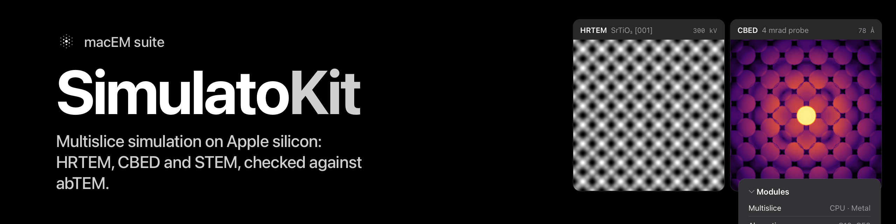

<p align="center"></p>

# SimulatoKit

[](https://github.com/mac4DSTEM/SimulatoKit/actions/workflows/ci.yml)
[](https://mac4dstem.github.io/SimulatoKit/documentation/)
[](https://github.com/mac4DSTEM/SimulatoKit/tags)
[](LICENSE)

A Swift package for simulating electron scattering on Apple platforms: projected potentials, multislice propagation,
frozen phonons, probes with aberrations, STEM scans with detectors, and the contrast transfer function for HRTEM images.
It is a port of [abTEM](https://github.com/abtem/abtem) 1.0.10, checked against abTEM in float64 (Python reference, pinned
inputs). The algorithms and the Lobato–Van Dyck (2014) parameters are abTEM's; credit
for the method belongs to the abTEM authors. Licence: GPL-3.0-only (`LICENSE`, `NOTICE`); software built on
SimulatoKit must be GPL-compatible. It is a library of numbers, not an application, and has no UI. It stands alone: it
depends on no other package, and no other package depends on it yet.

Current release: **0.4.0**. API reference (DocC, one catalogue per module):
[mac4dstem.github.io/SimulatoKit](https://mac4dstem.github.io/SimulatoKit/documentation/), published from every tag.

## Modules

| Product | What it does |
|---|---|
| `SimulatoCore` | the electron beam (wavelength, interaction parameter), grids of any length from 2, complex and real fields, waves (intensity, diffraction pattern, beam tilt, Fourier resampling `Waves.resampled`), the antialias aperture, a minimal orthogonal-cell `AtomicStructure`, a float64 FFT; on images: `integratingGradient`, `integrateDisc`, `tiled` |
| `SimulatoMultislice` | the Lobato parameterisation, slicing, the projected potential (from a grid or a sampling), transmission and Fresnel propagation, `Multislice.run` / `runBatch` on `.cpu` and `.metal`, frozen phonons, `ExecutionOptions` and `MetalAccuracy` |
| `SimulatoProbe` | the soft aperture, polar aberrations C10 to C56, the probe at a position, `GridScan` and `LineScan`, `ContrastTransferFunction` (envelopes, Scherzer defocus, point resolution) and `Waves.applying` for HRTEM |
| `SimulatoDetector` | annular (BF, ADF, HAADF), pixelated (4D-STEM), segmented (DPC), `CenterOfMassDetector` and `WavesDetector` (the exit wave at every position); `STEM.scan` over a grid or a line, averaged over frozen-phonon configurations; line interpolation (`interpolateLine`) and line profiles (`lineProfiles(for:)`), integrated centre of mass (`integratedCenterOfMass`), Gaussian source size and Poisson noise |

## Installation

```swift
.package(url: "https://github.com/mac4DSTEM/SimulatoKit", from: "0.4.0")
// target dependencies, as needed:
.product(name: "SimulatoMultislice", package: "SimulatoKit")  // also SimulatoCore, SimulatoProbe, SimulatoDetector
```

Swift 6.2 tools, Swift 6 language mode. Platforms: macOS 15 and iOS/iPadOS 18 (from 0.2.0). Every module, the Metal
path included, builds for both (MPSGraph's FFT needs macOS 14 / iOS 17, `Synchronization.Mutex` macOS 15 / iOS 18); the
tests and the consumer checks run on macOS, where the numbers are validated. Developed and tested on macOS 27.
Build with `-c release`: the FFT and potential loops are many times slower unoptimised. Grid lengths are any integer of at least 2
(Accelerate's DFT where it has the length, Bluestein's algorithm otherwise; both backends). Cells are orthogonal.

## From abTEM

Names checked against the sources and `docs/parity.md` (which lists every abTEM entry, ported or not).

| abTEM | SimulatoKit |
|---|---|
| `Potential(atoms, gpts, slice_thickness)` | `Potential(structure:nx:ny:sliceThickness:)` |
| `Potential(atoms, sampling=0.1, ...)` | `Potential(structure:sampling:sliceThickness:)` |
| `PlaneWave(tilt=...)` | `Waves.planeWave(beam:grid:tilt:)` |
| `Probe(semiangle_cutoff, energy, tilt=...)` | `Probe(beam:grid:aperture:aberrations:tilt:)` |
| `waves.multislice(potential)` | `Multislice.run(_:through:exitPlanes:backend:)` |
| `waves.intensity()` | `Waves.intensity()` |
| `waves.diffraction_patterns(max_angle=...)` | `Waves.diffractionPattern(maxAngle:)` |
| `CTF(...)`, `waves.apply_ctf(ctf)` | `ContrastTransferFunction(aberrations:...)`, `Waves.applying(_:)` |
| `GridScan(start, end, gpts)`, `GridScan(..., sampling=)` | `GridScan(start:end:nx:ny:)`, `GridScan(start:end:samplingX:samplingY:)` |
| `LineScan(start, end, gpts)`, `.add_margin`, `.at_position` | `LineScan(start:end:gpts:...)`, `.addingMargin`, `.atPosition` |
| `measurement.interpolate_line(...)`, `RealSpaceLineProfiles.width` | `RealField.interpolateLine(...)`, `ScanMeasurement.lineProfiles(for:)`, `RealSpaceLineProfiles.width(height:)` |
| `dp.center_of_mass().integrate_gradient()` (iCOM) | `ScanMeasurement.integratedCenterOfMass(samplingX:samplingY:)` |
| `WavesDetector(gpts)` | `WavesDetector(rows:columns:)`, `STEM.scan(probe:potentials:scan:detector:...)` → `ScanWaves`; frozen phonons: `STEM.scanFrozenPhonons` → `[ScanWaves]` |
| `dp.center_of_mass()`, `dp.gaussian_source_size(s)`, `.poisson_noise(...)` | `CenterOfMassDetector`, `ScanMeasurement.gaussianSourceSize(...)`, `.poissonNoise(...)` |
| `probe.scan(potential, scan, detectors)` | `STEM.scan(probe:potentials:scan:detectors:backend:)` |
| `AnnularDetector`, `PixelatedDetector`, `SegmentedDetector` | the same names, with labelled initialisers |
| `FrozenPhonons(atoms, num_configs, sigmas, seed)` | `FrozenPhonons(structure:sigmas:configurations:seed:directions:)` |

## Platform

macOS 15 or later and iOS/iPadOS 18 or later (`Package.swift`). Linux is not supported yet: the FFT uses Apple's
Accelerate framework, and the GPU backend uses Metal and MPSGraph.

## Please cite

SimulatoKit is a port of abTEM. If you use it in published work, please cite abTEM: J. Madsen and T. Susi, "The abTEM
code: transmission electron microscopy from first principles", Open Research Europe 1, 24 (2021), and, for the
scattering parameters, I. Lobato and D. Van Dyck, Acta Cryst. A 70, 636-649 (2014), doi:10.1107/S205327331401643X.
`CITATION.cff` has the same references in machine-readable form.

## Quick start

```swift
import SimulatoCore
import SimulatoMultislice
import SimulatoProbe
import SimulatoDetector

let a = 4.05, h = a / 2   // fcc Al, Å
let cell = try AtomicStructure(box: SIMD3(a, a, a), atoms: [
    .init(atomicNumber: 13, position: SIMD3(0, 0, 0)), .init(atomicNumber: 13, position: SIMD3(0, h, h)),
    .init(atomicNumber: 13, position: SIMD3(h, 0, h)), .init(atomicNumber: 13, position: SIMD3(h, h, 0))])
let beam = try ElectronBeam(energy: 300e3)   // eV
let backend: Backend = Multislice.metalIsAvailable ? .metal : .cpu
// A Potential is the sliced structure: built on the GPU slice by slice on .metal, or on the CPU (`build()`) on .cpu.
let potential = try Potential(structure: cell.repeated(3, 3, 10), nx: 256, ny: 256, sliceThickness: 2)

// HRTEM: plane wave, multislice, CTF at Scherzer defocus (Cs = 1 mm; lengths in Å)
let exit = try Multislice.run(.planeWave(beam: beam, grid: potential.grid), through: potential, backend: backend)[0]
var ab = Aberrations()
ab.Cs = 1e7
ab.defocus = try ContrastTransferFunction.scherzerDefocus(Cs: 1e7, energy: 300e3)
let hrtem = try exit.applying(ContrastTransferFunction(aberrations: ab)).intensity()   // RealField

// STEM HAADF: 20 mrad probe over one unit cell, annular detector 70 to 200 mrad
let probe = try Probe(beam: beam, grid: potential.grid, aperture: Aperture(semiangleCutoff: 20))
let scan = try GridScan(start: SIMD2(0, 0), end: SIMD2(a, a), nx: 16, ny: 16)
let haadf = try STEM.scan(probe: probe, potentials: [potential], scan: scan,
                          detectors: [AnnularDetector(inner: 70, outer: 200)],
                          backend: backend)[0]   // ScanMeasurement: values over the scan
```

## Backends

`Backend.cpu` is the reference: float64 on Accelerate (vDSP); scans and batches use up to 8 threads. `Backend.metal`
runs in float32 on the GPU (MPSGraph) behind the same API: for a `Potential` the projected potential is built on the GPU
slice by slice, the transmission functions always are, the wave stays on the device, and scans build their probes and
diffraction intensities there too; one compiled step is encoded per slice into one command buffer. Without a Metal
device it throws `SimulatoError.metalUnavailable` (`Multislice.metalIsAvailable` tells beforehand). The registered
tolerances of Metal against the CPU: exit wave 1e−4, intensity, diffraction pattern and detector images 2e−4 relative to
the maximum, total intensity 1.5e−6 per slice, up to 100 slices; measured, the wave
is within about 5e−5 and the total intensity within 5e−7 per slice (1.4e−7 on light elements) at up to 1024² with 100
slices. Detector images are bounded by 2e−4 × max(their maximum, 1e−5 of the probe's intensity): weaker signals sit at
float32's noise floor (`MetalAccuracy.registered.detectorBound(imageMaximum:incidentIntensity:)`).

Measured speed (Apple M5 Pro, macOS 27; fcc Al at 300 keV, 100 slices, about 0.047 Å per pixel; from the structure to the
numbers, the potential included):

| Grid | Plane wave exit: Metal / CPU | 64 × 64 HAADF scan: Metal / CPU | Metal peak memory |
|---|---|---|---|
| 256² | 0.09 s / 0.59 s | 17 s / 516 s | 1.0 GB |
| 512² | 0.13 s / 4.4 s | 90 s / 2521 s | 1.3 GB |
| 1024² | 0.28 s / 54 s | 408 s / 15157 s | 1.7 GB |

The CPU scans run 8 threads and were timed on a subset of positions and scaled (linear in positions). Measured while other builds
ran, which slows the CPU side most: read the Metal-to-CPU ratios as upper bounds (re-measuring on an idle machine is #5).

## Choices and their defaults

Every choice the kit makes has a parameter, and the default is the value the numbers were validated with:
`ExecutionOptions` (`options:` on `Multislice.run`, `Multislice.runBatch` and `STEM.scan`: CPU threads, Metal batch memory
and shapes, the CPU scan's chunk, the Metal renormalisation and executable cache), `MetalAccuracy.registered` (the
Metal-against-CPU bounds the tests hold), `Grid.matches(_:relativeTolerance:)`, the slice ceiling (`maximumSliceCount:`)
and the constants of `scherzerDefocus`, `pointResolution` and `nyquistSampling`. abTEM's own conventions (the antialias
aperture, the slicing rules, the π choice in `LobatoParameterization`) stay as abTEM defines them.

```swift
// continuing the quick start: its 256 probe positions as a batch, with smaller Metal batches and fewer CPU threads
var options = ExecutionOptions.standard
options.maximumCPUThreads = 4
options.metalBatchBytes = 128 << 20
let probes = try scan.positions.map { try probe.build(at: $0) }
let exits = try Multislice.runBatch(probes, through: potential, backend: backend, options: options)
```

## How the numbers are checked

Numbers are held to the Python reference within its own tolerance; `docs/parity.md` lists each function, its state and its tolerance.

- **Pins against abTEM 1.0.10** (`164e644`) in float64: wavelength, potentials, probes, exit waves, patterns, detectors,
  CTF kernels and HRTEM images agree within 1e−10 of the array's maximum or tighter (measured 1e−13 to 1e−16, with
  abTEM's float32 π reproduced by `.abTEMFloat32`), and within 1e−6 with the kit's default exact π.
- **Truth tests** independent of abTEM: Kirkland's table, the k = 0 identity, the far field, vacuum propagation, slice
  symmetry, the probe, the aberration phase, the thickness series.
- **`tools/consumer-check`**: a separate package that uses the whole public API from outside.

## What is not claimed


- Nothing is validated against a micrograph. Partial coherence is abTEM's envelope approximation; there is no detector
  response; the only noise is `ScanMeasurement.poissonNoise` (the kit's own generator, not NumPy's stream). Frozen phonons use Einstein σ given by the caller, and agree with abTEM exactly only when abTEM's
  displacements are supplied (otherwise in distribution).
- Metal's float32 FFT is not exactly unitary (it loses about 8e−7 of the total intensity per slice; a per-step
  renormalisation brings that to 5e−7 or less); the Metal bounds are registered to 100 slices, and past 300 slices the
  pattern error exceeds its bound.
- Cells are orthogonal and always periodic; atoms in the gap of a short slice list are kept (abTEM drops them);
  `.afterSlices` always adds the last slice. Finite projections, rotated or cut cells and some of abTEM's options are not
  ported (`docs/parity.md`). `AtomicStructure` and the example's CIF reader are minimal local stand-ins.

## Known limits

- MPSGraph's float32 FFT is not exactly unitary (`tools/metal-fft-gain/`); weak high-angle signals on Metal sit at
  float32's floor, so the detector bound is floored (`MetalAccuracy.detectorBound`); use `.cpu` for them. Unphysical
  phases (σV above about 200 rad in one pixel column) break the Metal bounds.
- The Metal bounds hold to 100 slices and grids to 1024²; past 300 slices the pattern error exceeded its bound (not
  re-measured with the renormalisation). Re-measure after OS updates.
- Not validated against a micrograph; frozen phonons agree with abTEM only when abTEM's displacements are given; segmented
  detectors sum in float64 where abTEM sums in float32 (agreement about 2e−7).
- A `ProjectedPotential` on `.metal` uploads every slice; prefer `Potential` for large Metal runs. `AtomicStructure` and the
  example's CIF reader are deliberately minimal: the kit stays standalone.

## Running the example

```sh
swift run -c release SimulatoExample [file.cif] [output-directory]
```

Without arguments it uses the bundled `Examples/SimulatoExample/Al.cif`, builds a 3 × 3 × 10-cell crystal on 256², and writes
`Al-hrtem.png` (CTF at Scherzer defocus, 300 keV, Cs = 1 mm, focal spread 30 Å), `Al-haadf.png` (16 × 16 scan over one
cell, 70 to 200 mrad) and `Al-numbers.csv` to the current directory, printing the image statistics and the HAADF values,
on Metal when a device exists. It takes a few seconds.
The CIF must have an orthogonal cell.

## Tests

```sh
swift test -c release
```

Use `swift test -c release` rather than `swift build --build-tests -c release`, which fails on the current toolchain. The
abTEM reference (a Python virtual environment) is not in the repository; `tools/README.md` sets it up from
`tools/requirements.txt`, and the `tools/pins/*/pins.py` scripts regenerate the fixtures in place. `swift test -c release --skip SimulatoKitParityTests` runs only the fast unit tests.

## Contributing and licence

Issues and pull requests are welcome; see `CONTRIBUTING.md`. A change that moves a number needs a test that fails when
the code is broken and a comparison against abTEM; say which. GPL-3.0-only; see `LICENSE` and `NOTICE`.
